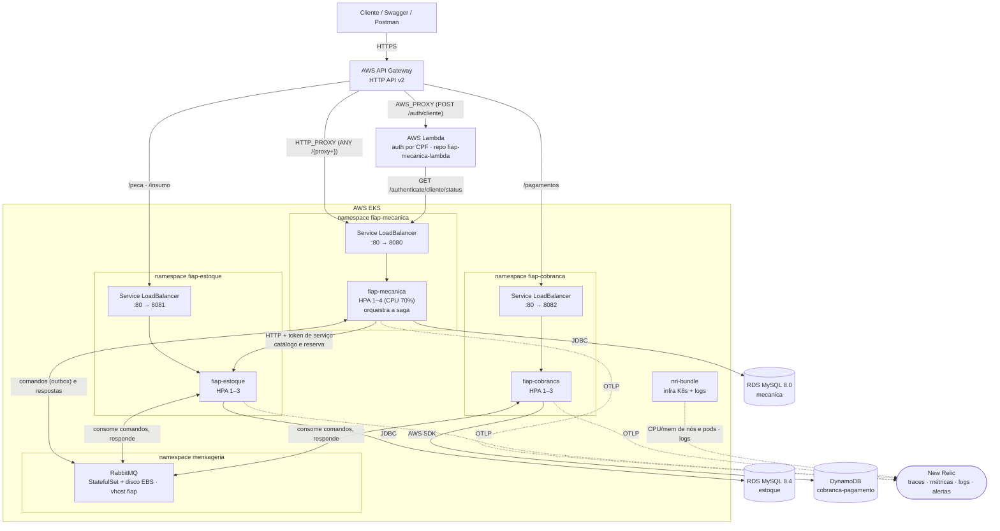

# Mecânica FIAP

[](https://sonarcloud.io/project/overview?id=ArthurPeruzzo_fiap-mecanica) [](https://sonarcloud.io/project/overview?id=ArthurPeruzzo_fiap-mecanica)

API REST para gestão de uma oficina mecânica, desenvolvida como projeto acadêmico na FIAP. O sistema cobre o ciclo completo de uma ordem de serviço — da abertura ao diagnóstico, orçamento, aprovação, execução e entrega — com reserva de estoque de peças e insumos (microsserviço `fiap-estoque`) e autenticação baseada em perfis de acesso.

Este é o repositório da **aplicação principal** (Fases 3 e 4): além do código da API, que **orquestra a saga de pagamento** da ordem de serviço, contém a infraestrutura específica da aplicação (ECR, API Gateway e alertas/dashboards New Relic) e o pipeline que faz o deploy no cluster Kubernetes. VPC/EKS, o banco gerenciado e a Function Lambda de autenticação vivem em [três repositórios separados](#estrutura-em-4-repositórios), e os microsserviços `fiap-estoque` e `fiap-cobranca` têm repositório, banco e pipeline próprios ([Fase 4](#fase-4--microsserviços-e-saga-de-pagamento)).

## Objetivos

- Gerenciar clientes, veículos, mecânicos e atendentes
- Controlar o ciclo de vida de ordens de serviço
- Reservar e liberar estoque de peças e insumos ao vincular/desvincular itens de ordens, delegando ao microsserviço `fiap-estoque`
- Restringir operações por perfil: administrador, atendente, mecânico e cliente
- Orquestrar a saga de pagamento da OS (cobrança, depois baixa do estoque) com compensação em caso de falha, em parceria com `fiap-cobranca` e `fiap-estoque`

### Fase 3 — Objetivo desta etapa

Partindo da Fase 2 (Clean Architecture no código, containerização via Docker, orquestração no EKS, provisionamento com Terraform e CI/CD com deploy automático a cada merge na `main`), a Fase 3 adiciona:

- **API Gateway** (AWS HTTP API v2) como porta de entrada única, com URL estável e TLS.
- **Autenticação serverless por CPF**: uma AWS Lambda valida o CPF do cliente, confirma o cadastro na base de dados e devolve um JWT para consumo das rotas protegidas.
- **Observabilidade ponta a ponta** com New Relic: traces e métricas via OTLP, consumo de CPU/memória do cluster, healthchecks, alertas e dashboards de negócio.
- **Infraestrutura separada em 4 repositórios**, cada um com CI/CD próprio e deploy automático.

### Fase 4 — Microsserviços e saga de pagamento

O sistema passou a três microsserviços independentes, cada um com repositório, infraestrutura, pipeline e banco próprios:

| Serviço | Responsabilidade | Banco |
|---|---|---|
| `fiap-mecanica` (este) | Ordem de serviço, clientes, veículos, orçamento e **orquestração da saga** | MySQL (RDS) |
| `fiap-estoque` | Peças, insumos, reservas e baixa de estoque | MySQL (RDS próprio) |
| `fiap-cobranca` | Pagamento da ordem de serviço | DynamoDB (NoSQL) |

Nenhum serviço acessa o banco de outro. A comunicação é **síncrona** (HTTP, com token de serviço, ADR-0007) onde a resposta é
necessária na hora (consultar catálogo e reservar estoque ao abrir ou alterar a OS) e **assíncrona** (RabbitMQ, comandos e respostas,
ADR-0008) para o fluxo de pagamento e de compensação.

**Estratégia da saga: orquestrada** (decisão e alternativas em [ADR-0008](docs/adr/0008-mensageria-rabbitmq-outbox.md) e
[ADR-0009](docs/adr/0009-saga-de-pagamento-orquestrada.md)). Esta aplicação, dona do estado da OS, manda **comandos** e reage às
**respostas**; os outros serviços não conhecem o ciclo de vida da OS (na coreografia o estoque teria de reagir a eventos da OS). Cada
comando passa por uma *outbox* gravada na mesma transação da mudança de estado, então nenhum comando se perde se o broker cair.

1. Aprovar o orçamento move a OS para `AGUARDANDO_PAGAMENTO` e enfileira `pagamento.solicitar` para a cobrança.
2. A cobrança grava o pagamento `PENDENTE` e chama o meio de pagamento (um mock HTTP com token, Retry e CircuitBreaker, ver o
   [ADR-0002 do `fiap-cobranca`](https://github.com/ArthurPeruzzo/fiap-cobranca/blob/main/docs/adr/0002-mock-do-meio-de-pagamento.md)),
   que aprova ou recusa; ela responde `pagamento.confirmado` ou `pagamento.recusado`. Se o meio estiver fora, o pagamento fica
   `PENDENTE` e a equipe o decide à mão (`/pagamentos/{os}/aprovar|recusar`).
3. Pagamento confirmado: a OS pede ao estoque a baixa das reservas; `baixa.confirmada` leva a OS a `EM_EXECUCAO` (fim da saga).
4. Pagamento recusado (compensação B): a OS vai para `CANCELADA` e a reserva do estoque é liberada (`reserva.liberada` encerra a compensação).

O orçamento recusado pelo cliente ou pelo atendente (compensação A) também cancela a OS e libera as reservas (`reserva.liberar` pela
outbox), sem passar pela cobrança. Cobra-se primeiro e baixa-se o estoque depois, então nenhuma falha exige estorno: a compensação é
sempre liberar a reserva e cancelar a OS. Respostas repetidas ou atrasadas são ignoradas (idempotência) e mensagens inválidas vão para a
DLQ. Riscos aceitos: pagamento `PENDENTE` que nunca é decidido segura a OS e a reserva, e não há estorno depois de um pagamento confirmado.

## Stack

**Aplicação**

- Java 25 · Spring Boot 4.0.5
- Spring Web MVC · Spring Security + JWT (Auth0 `java-jwt`)
- Spring Data JPA + Hibernate · Flyway · Lombok
- SpringDoc OpenAPI (Swagger UI)
- Micrometer + OpenTelemetry (exportação OTLP) · logs estruturados em JSON (formato ECS)
- Spring AMQP · RabbitMQ (comandos e respostas da saga, com outbox transacional)
- Testcontainers · MySQL 8.4 (Docker Compose e testes; o RDS na AWS é MySQL 8.0)

**Plataforma**

- Docker · Kubernetes (AWS EKS) com HorizontalPodAutoscaler
- AWS API Gateway (HTTP API v2) · AWS Lambda (Node.js + TypeScript — repositório `fiap-mecanica-lambda`)
- Amazon RDS for MySQL (mecanica e estoque) · Amazon DynamoDB (cobrança)
- RabbitMQ no cluster (namespace `mensageria`, StatefulSet com disco EBS), mantido pelo CD do `fiap-estoque`
- Terraform (um root module por repositório de infra)
- New Relic (APM via OTLP, integração Kubernetes `nri-bundle`, alertas e dashboards)
- GitHub Actions (CI/CD)

## Arquitetura de runtime



A aplicação é um **monolito modular** organizado segundo os princípios da **Clean Architecture**. Cada módulo de negócio é dividido em duas camadas, com uma regra de dependência única: **as dependências apontam sempre para dentro**, em direção ao domínio — nunca o contrário.

- **`core/` (domínio)** — regras de negócio em Java puro, sem nenhuma dependência de Spring, JPA ou HTTP. Concentra as entidades de domínio, os *use cases* (casos de uso), os DTOs e as **interfaces de gateway**. É o coração do sistema e não conhece frameworks nem banco de dados.
- **`infra/` (infraestrutura)** — os detalhes que servem ao domínio: controllers HTTP, implementações dos gateways (persistência JPA), entidades de banco, segurança e serialização. Depende do `core`, jamais o inverso.

### Módulos de negócio

| Módulo | Responsabilidade |
|---|---|
| `gestao` | Clientes, veículos, mecânicos e atendentes |
| `ordemdeservico` | Ciclo de vida da ordem de serviço, serviços, orçamento e notificações. Consulta o catálogo e reserva estoque no microsserviço `fiap-estoque` por HTTP |
| `shared` | Segurança/JWT, tratamento global de exceções, *value objects*, paginação, notificação e métricas |

## Estrutura em 4 repositórios

A Fase 3 exige a infraestrutura dividida em quatro repositórios, cada um com CI/CD independente e deploy automático no push para a `main`.

| Repositório | O que contém |
|---|---|
| **`fiap-mecanica`** (este) | Código da aplicação + `infra/terraform/app-infra` (ECR), `infra/terraform/apigateway` (API Gateway), `infra/terraform/aws` (alertas + dashboards New Relic). Pipeline de build, deploy no EKS e apply desses módulos. |
| **`fiap-mecanica-infra-k8s`** | VPC, subnets, cluster EKS + node group e os add-ons de cluster (metrics-server, `nri-bundle` da New Relic). |
| **`fiap-mecanica-infra-db`** | Amazon RDS for MySQL — instância, subnet group e security group. |
| **`fiap-mecanica-lambda`** | Function Lambda de autenticação de cliente por CPF (Node.js + TypeScript) + seu Terraform. |

Na Fase 4 entram mais dois repositórios, de microsserviço: **`fiap-estoque`** (RDS próprio, RabbitMQ no cluster, ECR, manifestos e pipeline) e **`fiap-cobranca`** (tabela DynamoDB, ECR, manifestos e pipeline). Eles dependem só do cluster, não do banco deste repositório.

Existe ainda o **`fiap-mecanica-gestao`**, extração em andamento de clientes e veículos (estratégia *strangler fig*, passo 1). **Não faz parte do ambiente validado:** o API Gateway não roteia para ele, o monólito continua dono de clientes e veículos, e o repositório ainda não tem análise Sonar nem gate de cobertura. Os três serviços da Fase 4 são `fiap-mecanica`, `fiap-estoque` e `fiap-cobranca`.

**Dependência entre os states Terraform** (leitura via `terraform_remote_state` — mesmo bucket S3, chaves distintas):

```
infra-k8s  ◄──  infra-db  ◄──  app-infra / apigateway
                               lambda (state próprio, independente)
```

**Ordem de deploy numa infra do zero:** `infra-k8s` → (`infra-db`, `lambda` e `fiap-estoque`, que podem rodar em paralelo) → `fiap-cobranca` (precisa do broker e do usuário criados pelo CD do estoque) → `fiap-mecanica`, esperando cada CD ficar verde antes do próximo. Como a Lambda, o estoque e a cobrança já estão no ar quando o `fiap-mecanica` roda, as rotas `POST /auth/cliente`, `/peca`, `/insumo` e `/pagamentos` são criadas na primeira passada. Não há gatilho automático entre os repositórios — cada CD dispara no push da própria `main`. (Só é preciso re-executar o CD do `fiap-mecanica` se ele rodar **antes** de a Lambda, do estoque ou da cobrança existirem — o job `apigw-apply` detecta e avisa.)

## Autenticação

Duas formas de obter um token JWT (HS256):

**Funcionário** — `POST /authenticate/login` com `{ "cpf": "...", "password": "..." }`. A própria aplicação valida e assina o token com o perfil correspondente (`ROLE_ADMINISTRADOR`, `ROLE_ATENDENTE` ou `ROLE_MECANICO`).

**Cliente (Fase 3)** — `POST /auth/cliente` (pelo API Gateway) com `{ "cpf": "..." }`. O gateway encaminha para a Lambda, que:

1. valida o formato do CPF;
2. chama `GET /authenticate/cliente/status?cpf=...` na aplicação, que confirma que o CPF pertence a um cliente cadastrado e cria um `User` com `ROLE_CLIENTE` na primeira vez;
3. assina o JWT (HS256, segredo compartilhado com a aplicação, `sub` = id do usuário).

O token vai no header `Authorization: Bearer <token>` nas demais requisições. O token de cliente dá acesso a `GET /ordem-servico/minhas-ordens`.

O gateway apenas **roteia** (`ANY /{proxy+}` → ELB via `HTTP_PROXY`, header `Authorization` repassado intacto); a autorização por rota e perfil continua inteiramente na aplicação (`SecurityConfiguration` + `UserAuthenticationFilter`). Os trade-offs desta estratégia estão registrados no [ADR-0006](docs/adr/0006-jwt-hs256-segredo-compartilhado.md) e no [RFC-0003](docs/rfc/0003-estrategia-de-autenticacao.md).

## Observabilidade

- **Traces e métricas** da aplicação são exportados via **OTLP** para a New Relic (Micrometer + OpenTelemetry). Métricas de negócio: `os.criadas`, `os.duracao{fase}`.
- **Consumo do cluster** (CPU/memória de nós e pods) e **logs** chegam pela integração Kubernetes da New Relic (`nri-bundle`), instalada pelo CD do `fiap-mecanica-infra-k8s`.
- **Logs estruturados em JSON** (formato ECS), com `traceId` / `spanId` (campos de topo) para correlação com os traces.
- **Trace distribuído entre os serviços:** o `traceparent` W3C segue nas chamadas HTTP ao estoque e atravessa a outbox e o RabbitMQ (o relay grava e reenvia o contexto da requisição; os listeners abrem o span do consumo como filho dele). Como o meio de pagamento decide durante o consumo do comando, aprovar o orçamento gera **um único trace** que passa por mecanica → cobrança → mecanica → estoque; só um pagamento `PENDENTE` decidido à mão abre um segundo trace (cobrança → mecanica → estoque). Os logs de cada pod carregam o mesmo `traceId`, o que permite seguir a OS entre eles (`kubectl logs ... | grep <traceId>`).
- **Dashboards** (Terraform, `infra/terraform/aws/newrelic-dashboards.tf`):
  - *Observabilidade de Negócio* — volume diário de OS, tempo médio por fase (diagnóstico / execução / entrega), taxa de erro, erros por rota, falhas de acesso ao banco.
  - *Performance e Disponibilidade* — latência das APIs (p50/p90/p95/p99), uptime do healthcheck, CPU/memória dos pods.
- **Alertas** (`infra/terraform/aws/newrelic-alerts.tf`) → e-mail: 5xx em rotas `/ordem-servico/**` e healthcheck do `/actuator/health` falhando.

## Rodando localmente

### Pré-requisitos

| Pré-requisito |
|---|
| Docker + Docker Compose |

### Clone do repositório

Realize o clone do repositório em sua máquina local.

```
git clone https://github.com/ArthurPeruzzo/fiap-mecanica.git
```

### Configuração de variáveis de ambiente

O `docker-compose.yml` não traz credenciais nem o `JWT_SECRET` fixos no arquivo — eles vêm de um arquivo `.env` local, que **não é versionado** (está no `.gitignore`). Antes do primeiro `docker compose up`, copie o template:

```
cp .env.example .env
```

O `.env.example` já traz valores padrão (`root`/`root`) suficientes para rodar localmente sem nenhum ajuste.

| Variável | Descrição |
|---|---|
| `DB_ROOT_PASSWORD` | Senha do usuário `root` do MySQL (container `db`) |
| `DB_USERNAME` | Usuário usado pela aplicação para conectar ao banco |
| `DB_PASSWORD` | Senha usada pela aplicação para conectar ao banco |
| `JWT_SECRET` | Chave usada para assinar/validar os tokens JWT. Deve ser uma string Base64URL com no mínimo 32 bytes decodificados |
| `SERVICE_JWT_SECRET` | Chave do token de serviço enviado ao `fiap-estoque`. Base64URL, mínimo 32 bytes, **diferente** do `JWT_SECRET` e igual à do estoque (ver [ADR-0007](docs/adr/0007-token-de-servico-entre-microsservicos.md)) |
| `RABBITMQ_ADMIN_USER` / `RABBITMQ_ADMIN_PASSWORD` | Administrador do broker (container `rabbitmq`); só o script de inicialização usa |
| `RABBITMQ_VHOST` | Virtual host do broker (padrão `fiap`) |
| `RABBITMQ_USERNAME` / `RABBITMQ_PASSWORD` | Usuário desta aplicação no broker (publica em `estoque.comandos` e `cobranca.comandos` e é dono da fila de respostas `ordemservico.respostas`) |
| `RABBITMQ_ESTOQUE_USERNAME` / `RABBITMQ_ESTOQUE_PASSWORD` | Usuário do `fiap-estoque` no broker; o serviço `rabbitmq-init` o cria, e o estoque usa o mesmo par em `RABBITMQ_USERNAME`/`RABBITMQ_PASSWORD` do `.env` dele. Use valores alfanuméricos |
| `RABBITMQ_COBRANCA_USERNAME` / `RABBITMQ_COBRANCA_PASSWORD` | Usuário do `fiap-cobranca` no broker; o `rabbitmq-init` o cria e a cobrança usa o mesmo par no `.env` dela |

> O Docker Compose carrega o `.env` automaticamente por estar no mesmo diretório do `docker-compose.yml` — não é preciso passar nenhuma flag adicional.

### Docker Compose

Sobe a aplicação e o banco de dados juntos, sem necessidade de instalar Java ou MySQL localmente.

```
# Comando utilizado para subir a aplicação
docker compose up
```

A aplicação ficará disponível em `http://localhost:8080`.

O `docker compose` também sobe o **RabbitMQ** (`localhost:5672`; painel de gerenciamento em `http://localhost:15672`, com o usuário `RABBITMQ_ADMIN_USER`) e executa o serviço de uso único `rabbitmq-init`, que cria o virtual host e os usuários de menor privilégio. O broker é compartilhado com o `fiap-estoque` e o `fiap-cobranca`, que se conectam em `localhost:5672`. Quando um orçamento é recusado, a liberação do estoque segue por mensageria (ver [ADR-0008](docs/adr/0008-mensageria-rabbitmq-outbox.md)); se o broker ou o estoque estiverem fora do ar, o cancelamento da OS não é afetado e o comando é entregue quando voltarem.

O MySQL ficará acessível no host em `localhost:3307` (útil para conectar com DBeaver ou outro cliente SQL). Com os valores padrão do `.env.example`:

| Campo | Valor |
|---|---|
| Host | `127.0.0.1` |
| Porta | `3307` |
| Usuário | `root` |
| Senha | `root` (`DB_ROOT_PASSWORD` no `.env`) |
| Database | `mecanica` |

Para parar:

```
docker compose down        # mantém os dados do banco
docker compose down -v     # apaga os dados do banco também
```

As migrations do Flyway rodam automaticamente na inicialização e criam todas as tabelas.

## Deploy

**Produção — automático.** Cada `pull request` para a `main` dos repositórios dispara o **CI** (`ci.yml`: `verify` com testes, BDD e cobertura mínima de 80%, análise do SonarCloud com Quality Gate, build da imagem e `terraform plan`, sem aplicar nada). O merge dispara o **CD** (`cd.yml`), que faz o deploy na AWS, **sem repetir os testes**: em todos os repositórios a `main` é protegida e só aceita merge de pull request atualizado e com os checks obrigatórios verdes, inclusive para administradores (sem push direto nem force push): `build-test` e `terraform-plan` nos serviços e na Lambda (a mecanica só exige `build-test`), `terraform-plan` nos repositórios de infraestrutura e `build-test` no `fiap-mecanica-gestao`.

CD deste repositório, na ordem de execução:

| Job | O que faz |
|---|---|
| `app-infra-apply` | `terraform apply` de `infra/terraform/app-infra` — cria o ECR; lê `db_endpoint` e `eks_cluster_name` dos outros repositórios via `terraform_remote_state`. |
| `docker-build-push` | Builda a imagem versionada (versão do `pom.xml`) e publica no ECR. Falha se a tag já existir — faça o bump da versão antes do merge. |
| `newrelic-apply` | `terraform apply` de `infra/terraform/aws` — alertas e dashboards New Relic; descobre a URL do API Gateway para o monitor de uptime. |
| `k8s-deploy` | `kubectl apply` de namespace/secret/configmap/deployment/service/hpa, `kubectl set image` com a versão publicada e aguarda o rollout. Gera o ConfigMap com o `DB_URL` real (endpoint do RDS lido do job anterior). |
| `apigw-apply` | `terraform apply` de `infra/terraform/apigateway` — roda por último porque a integração `HTTP_PROXY` precisa do hostname do ELB, criado no `k8s-deploy`. Habilita `POST /auth/cliente` se a Lambda já existir e as rotas `/peca`, `/insumo` e `/pagamentos` se os Services do estoque e da cobrança já existirem. |

**Deploy manual / infra do zero:** ver os READMEs específicos — [`k8s/README.md`](k8s/README.md), [`infra/terraform/app-infra/README.md`](infra/terraform/app-infra/README.md), [`infra/terraform/apigateway/README.md`](infra/terraform/apigateway/README.md), [`infra/terraform/aws/README.md`](infra/terraform/aws/README.md) — e os repositórios `fiap-mecanica-infra-k8s`, `fiap-mecanica-infra-db` e `fiap-mecanica-lambda`.

**GitHub Secrets** (por repositório): credenciais AWS (`AWS_ACCESS_KEY_ID`, `AWS_SECRET_ACCESS_KEY`, `AWS_SESSION_TOKEN` — temporárias, rotacionam a cada sessão), além de `JWT_SECRET`, `SONAR_TOKEN` (análise do SonarCloud, nos 3 serviços), `NEW_RELIC_*` e `TF_VAR_DB_*` conforme o repo. O script `scripts/refresh-aws-secrets.sh` (na raiz do workspace) publica os secrets AWS nos 6 repositórios de uma vez.

## Usuários padrão

Funcionários criados automaticamente pelas migrations do Flyway. Todos compartilham a mesma senha:

| CPF | Senha | Perfil |
|---|---|---|
| `22255588846` | `MeCanica2026!@#` | Administrador |
| `33366699957` | `MeCanica2026!@#` | Atendente |
| `11144477735` | `MeCanica2026!@#` | Mecânico |

Use o token retornado no header `Authorization: Bearer <token>` nas demais requisições.

**Clientes** não têm senha — autenticam por CPF via `POST /auth/cliente` (ver [Autenticação](#autenticação)). Os dados de exemplo incluem o cliente de CPF `65997627004`.

## Dados de exemplo

A migration `V16` carrega um conjunto de dados iniciais com clientes, veículos, peças, insumos, serviços e ordens de serviço em todos os status possíveis, prontos para exploração imediata da API.

## Documentação da API

Swagger UI, gerado automaticamente via SpringDoc OpenAPI. Cada serviço tem o seu: o do `fiap-estoque` (porta 8081) e o do `fiap-cobranca` (porta 8082) ficam em `/swagger-ui.html` do próprio serviço, acessível pelo ELB do respectivo Service (o API Gateway só roteia `/peca`, `/insumo` e `/pagamentos`, não a documentação deles).

- **Local:** `http://localhost:8080/swagger-ui.html`
- **Produção:** a porta de entrada é o **API Gateway**, com URL estável entre deploys. Descubra a URL atual com:

  ```bash
  cd infra/terraform/apigateway && terraform output -raw api_gateway_url
  # → https://<id>.execute-api.us-east-1.amazonaws.com  (acrescente /swagger-ui.html)
  ```

  Ela também aparece no resumo (*Summary*) da run do CD. Alternativa direta pelo ELB — o hostname muda a cada recriação do Service:

  ```bash
  echo "http://$(kubectl get svc fiap-mecanica -n fiap-mecanica -o jsonpath='{.status.loadBalancer.ingress[0].hostname}')/swagger-ui.html"
  ```

## Testes

Os testes de integração usam Testcontainers e requerem Docker em execução.

```bash
./mvnw verify                        # toda a suíte (unitários, contrato, integração e BDD) + relatório e gate de cobertura
./mvnw test                          # só os testes, sem o gate
./mvnw test -Dtest=BddRunnerTest     # só o BDD
```

| Camada | Para que serve |
|---|---|
| Unitários | Regras de domínio e casos de uso isolados (Mockito) |
| Contrato | Controllers com `@WebMvcTest` e `MockMvc` |
| Integração | Aplicação completa com MySQL no Testcontainers e o `fiap-estoque` simulado em WireMock; uma regra ou caso de borda por método |
| BDD | Fluxos de negócio de ponta a ponta, descritos em Gherkin em português (abaixo) |

**Cobertura:** JaCoCo (`target/site/jacoco/index.html`). Medição de 10/11/2026: **97,5 % das linhas** (2.359 de 2.420), 96,8 % das instruções e 93,6 % dos branches, acima do mínimo de 80 %, que o `./mvnw verify` aplica (`jacoco:check`) e que reprova o CI abaixo disso. O resumo aparece em cada execução e o relatório HTML é publicado como artefato `jacoco-report`.

### BDD (Cucumber)

As especificações executáveis ficam em [`src/test/resources/features/`](src/test/resources/features/) e rodam em todo `mvn test` e no CI. São um **complemento** dos testes de integração, não uma substituição: contam os fluxos de negócio passo a passo, em linguagem que o negócio entende.

| Feature | Cenários |
|---|---|
| [`ciclo-completo.feature`](src/test/resources/features/ordem-de-servico/ciclo-completo.feature) | OS aprovada é paga, executada e entregue com a baixa do estoque: abertura com reserva, diagnóstico, orçamento (R$ 345 = 150 + 2×45 + 3×35), aprovação com pedido de pagamento à cobrança, confirmação do pagamento, baixa do estoque (uma única vez), execução, finalização e entrega |
| [`falhas-e-compensacao.feature`](src/test/resources/features/ordem-de-servico/falhas-e-compensacao.feature) | Estoque sem saldo, erro interno e resposta perdida (com liberação da reserva) ao abrir a OS; vincular peça sem saldo; pagamento recusado cancela a OS e agenda a liberação das reservas; resposta repetida da cobrança não pede a baixa duas vezes; cancelamento não depende do estoque |

**Evidência:** a cada execução o Cucumber gera o relatório passo a passo em `target/cucumber-reports/cucumber.html` (e `cucumber.json`). No CI, ele fica como artefato **`cucumber-report`** do workflow `build-test.yml` (GitHub → Actions → execução → Artifacts).

**Limite:** nestes cenários o `fiap-estoque` e o `fiap-cobranca` são simulados, então o BDD prova o que o monólito *pediu* a eles e em que ordem, não o efeito real no saldo nem no pagamento. Esse efeito é conferido contra o ambiente implantado, com uma bateria ponta a ponta pelo API Gateway (script local, não versionado neste repositório).

A estrutura do código do BDD (runner, contexto Spring, hooks e passos) está descrita no [`CLAUDE.md`](CLAUDE.md).

## Qualidade de código (SonarCloud)

O `build-test` do CI (pull request) roda `./mvnw verify` — testes, relatório do JaCoCo e mínimo de 80% de cobertura — e depois a
análise do **SonarCloud** (plano gratuito, repositório público) sobre as classes e o relatório já gerados. O passo usa
`-Dsonar.qualitygate.wait=true`: se o Quality Gate falhar, o pipeline falha. A configuração está nas propriedades `sonar.*` do
`pom.xml` (projeto `ArthurPeruzzo_fiap-mecanica`). Resultado: [painel do projeto no SonarCloud](https://sonarcloud.io/project/overview?id=ArthurPeruzzo_fiap-mecanica) (Quality Gate e cobertura da `main`; os pull requests têm a própria análise).

Configuração única, fora do repositório: criar a organização e importar este repositório em <https://sonarcloud.io>, conferir a
*organization key* e a *project key* (devem bater com o `pom.xml`) e cadastrar o secret **`SONAR_TOKEN`** no repositório. Enquanto o
secret não existir (ou em PR de fork), o passo é pulado com um aviso e o restante do pipeline segue normalmente.

## Documentação da Arquitetura

A documentação arquitetural — diagramas de componentes e de sequência, RFCs, ADRs, justificativa da escolha do banco e modelo de dados (ER) — fica em [`docs/`](docs/). As decisões da Fase 4 estão nos ADRs [0007](docs/adr/0007-token-de-servico-entre-microsservicos.md) (token de serviço), [0008](docs/adr/0008-mensageria-rabbitmq-outbox.md) (mensageria e outbox) e [0009](docs/adr/0009-saga-de-pagamento-orquestrada.md) (saga de pagamento).

## Linguagem Ubíqua

Dicionário de termos do domínio utilizados no sistema.

### Atores e entidades

| Termo | Definição |
|---|---|
| **Cliente** | Pessoa física (CPF) ou jurídica (CNPJ) proprietária de veículos cadastrados no sistema. |
| **Veículo** | Automóvel pertencente a um cliente, identificado pela placa. Um veículo não pode ter mais de uma ordem de serviço ativa simultaneamente. |
| **Atendente** | Funcionário responsável por abrir ordens de serviço, enviar orçamentos ao cliente, registrar a aprovação ou recusa e realizar a entrega do veículo. |
| **Mecânico** | Funcionário responsável por executar o diagnóstico e os serviços vinculados a uma ordem. O mecânico que inicia o diagnóstico torna-se o **mecânico responsável** por aquela ordem. |
| **Administrador** | Perfil com acesso irrestrito ao cadastro de clientes, veículos e serviços. Não opera ordens de serviço diretamente. |

### Estoque

| Termo | Definição |
|---|---|
| **Peça** | Item físico de estoque (cadastrado e mantido no `fiap-estoque`). Ex: pastilha de freio, correia dentada. |
| **Insumo** | Item consumível de estoque com unidade de medida variável (litros, ml, unidades). Ex: óleo de motor, fluido de freio. |
| **Reserva de Estoque** | Quantidade de uma peça ou insumo separada para uma ordem ao vinculá-la; ajustada ao vincular/desvincular. A reserva e o estoque ficam no `fiap-estoque`. |
| **Baixa de Estoque** | Confirmação das reservas da ordem, abatendo do estoque, depois que o pagamento é confirmado. |
| **Liberação de Reserva** | Devolução das reservas ao saldo disponível quando o orçamento ou o pagamento é recusado. |
| **Estoque Insuficiente** | Condição que impede o vínculo quando a quantidade solicitada supera o disponível (o estoque responde 422). |

### Pagamento e saga

| Termo | Definição |
|---|---|
| **Pagamento** | Registro da cobrança de uma ordem de serviço, guardado no `fiap-cobranca`. Status: **Pendente**, **Confirmado** ou **Recusado**. |
| **Saga de pagamento** | Sequência distribuída que vai da aprovação do orçamento até a baixa do estoque (ou a compensação), coordenada por esta aplicação (orquestrador). |
| **Compensação** | Desfazer o que a saga já fez quando uma etapa falha: liberar a reserva do estoque e cancelar a ordem. |
| **Outbox** | Tabela gravada na mesma transação da mudança de estado, de onde os comandos saem para o broker, para que nenhum comando se perca. |

### Ordem de Serviço

| Termo | Definição                                                                                                                            |
|---|--------------------------------------------------------------------------------------------------------------------------------------|
| **Ordem de Serviço** | Registro central do ciclo de atendimento de um veículo, desde a recepção até a entrega. Agrega serviços, peças e insumos vinculados. |
| **Diagnóstico** | Fase em que o mecânico responsável inspeciona o veículo e determina quais serviços, peças e insumos serão necessários.               |
| **Orçamento** | Valor total calculado ao concluir o diagnóstico, somando os preços de todos os serviços, peças e insumos vinculados naquele momento. |
| **Vínculo** | Associação de um serviço, peça ou insumo a uma ordem de serviço. A vinculação é permitida durante a criação da ordem (**Recebida**) e durante o diagnóstico (**Em Diagnóstico**). A desvinculação de peças e insumos é permitida somente durante o diagnóstico. |
| **Mecânico Responsável** | O mecânico que iniciou o diagnóstico de uma ordem de serviço. Somente ele pode continuar as operações daquela ordem.                               |
| **Link de Aprovação de Orçamento** | Token UUID gerado ao enviar o orçamento ao cliente. Tem validade de 3 dias e uso único. O cliente utiliza o link para aprovar ou recusar o orçamento sem necessidade de autenticação, desde que a ordem esteja em **Aguardando Aprovação**. |
| **Aprovação/Recusa pelo Atendente** | O atendente pode registrar a decisão do cliente diretamente pelo sistema, sem uso do link, desde que a ordem esteja em **Aguardando Aprovação**. |

### Ciclo de vida da Ordem de Serviço

| Status | Significado |
|---|---|
| **Recebida** | Ordem de Serviço criada pelo atendente. Aguardando que um mecânico inicie o diagnóstico. |
| **Em Diagnóstico** | Diagnóstico iniciado pelo mecânico responsável. Permite vincular serviços, peças e insumos. |
| **Diagnóstico Concluído** | Diagnóstico encerrado e orçamento calculado. Aguarda envio ao cliente. |
| **Aguardando Aprovação** | Orçamento enviado ao cliente via notificação com link de aprovação. O cliente ou o atendente registram a decisão. |
| **Aguardando Pagamento** | Orçamento aprovado. A cobrança registrou o pagamento e a ordem espera a decisão; só a saga encerra este estado. |
| **Em Execução** (Ordem de Serviço) | Pagamento confirmado e baixa do estoque concluída. Os serviços vinculados podem ser iniciados e finalizados individualmente pelo mecânico. |
| **Finalizada** | Todos os serviços vinculados foram concluídos. Aguarda entrega do veículo. |
| **Entregue** | Veículo devolvido ao cliente. Estado terminal positivo. |
| **Cancelada** | Orçamento recusado pelo cliente ou pagamento recusado. Estado terminal negativo. Reservas liberadas no estoque. |

### Execução de serviços

> Os status de serviço são independentes do status da Ordem de Serviço. Uma Ordem de Serviço pode estar **Em Execução** enquanto cada serviço vinculado evolui individualmente entre os estados abaixo.

| Termo | Definição |
|---|---|
| **Serviço** | Atividade catalogada que pode ser executada pela oficina, com preço e descrição definidos. Ex: alinhamento, troca de óleo. |
| **Serviço Vinculado** | Instância de um serviço associada a uma Ordem de Serviço específica, com preço e status de execução próprios. |
| **Não Iniciado** (serviço) | Serviço vinculado à Ordem de Serviço mas ainda não iniciado pelo mecânico. |
| **Em Execução** (serviço) | Serviço em andamento pelo mecânico responsável. |
| **Finalizado** (serviço) | Serviço concluído. Quando todos os serviços vinculados atingem este status, a Ordem de Serviço transita automaticamente para **Finalizada**. |
| **Tempo Médio de Execução** | Média das durações de todos os serviços finalizados de uma Ordem de Serviço. Ausente quando nenhum serviço foi concluído. |
