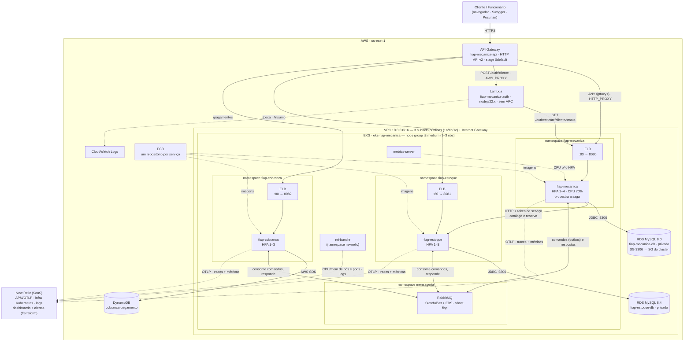
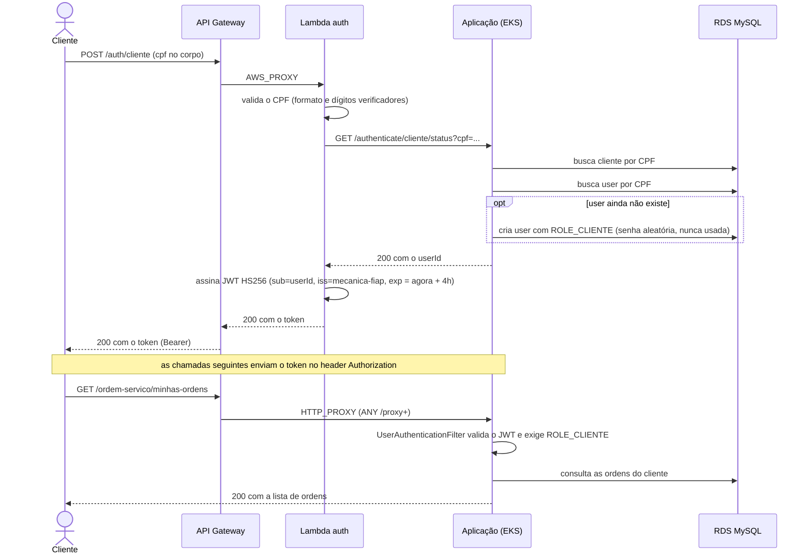
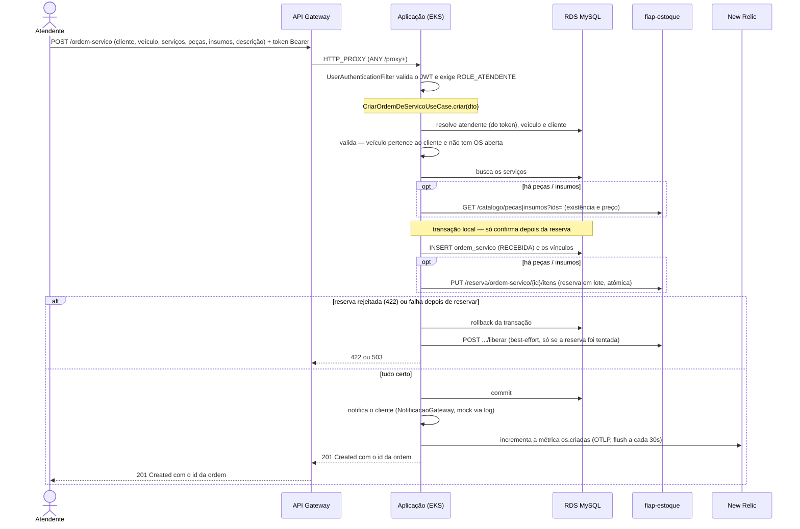

# Arquitetura — Mecânica FIAP

Visão de componentes da solução implantada na AWS: a API principal em Kubernetes, a Function
Lambda de autenticação, o API Gateway como porta de entrada, o banco gerenciado e a stack de
observabilidade. Todos os recursos são provisionados com Terraform, distribuídos nos
[4 repositórios](../README.md#estrutura-em-4-repositórios).

## Diagrama de Componentes

> O diagrama mostra os componentes de nuvem da solução inteira (Fases 3 e 4). A mecânica da saga, as filas e o trace distribuído
> estão na seção [Fase 4](#fase-4--microsserviços-mensageria-e-saga) mais abaixo. O diagrama consolidado da arquitetura final é
> mantido à parte.

## Legenda de componentes

| Componente | O que é | Provisionado por |
|---|---|---|
| **API Gateway** (`fiap-mecanica-api`) | HTTP API v2, stage `$default`. Porta de entrada única, com URL estável e TLS. Rota `ANY /{proxy+}` → ELB da aplicação (`HTTP_PROXY`); `POST /auth/cliente` → Lambda (`AWS_PROXY`) + `aws_lambda_permission`; na Fase 4, `ANY /peca` e `/insumo` (e `/{proxy+}` de cada) → ELB do `fiap-estoque` e `ANY /pagamentos` (e `/{proxy+}`) → ELB do `fiap-cobranca`, criadas só quando o Service correspondente já existe. Só roteia — não autentica. | `fiap-mecanica/infra/terraform/apigateway` |
| **Lambda** (`fiap-mecanica-auth`) | Function serverless (`nodejs22.x`, 256 MB, timeout 25s, **sem `vpc_config`** — precisa alcançar o ELB público). Valida o CPF, confirma o cliente chamando a aplicação e assina um JWT HS256. | `fiap-mecanica-lambda/infra/terraform/aws` |
| **ELB** | Load balancer criado pelo `Service` do tipo `LoadBalancer` (`:80` → `:8080`). Alvo da integração `HTTP_PROXY` do gateway; hostname muda a cada recriação (o CD descobre em runtime). | `fiap-mecanica/k8s/service.yaml` |
| **Pods / Deployment** | A aplicação Spring Boot. Imagem vinda do ECR; config via `envFrom` (ConfigMap + Secret); probes de liveness/readiness no Actuator. Escala por HPA (1–4 réplicas, CPU 70%). | `fiap-mecanica/k8s/*.yaml` + `cd.yml` (gera ConfigMap/Secret) |
| **EKS** (`eks-fiap-mecanica`) | Cluster Kubernetes gerenciado + managed node group (`t3.medium`, 1–3 nós EC2). | `fiap-mecanica-infra-k8s` (`eks-cluster.tf`, `eks-node.tf`) |
| **VPC / rede** | VPC `10.0.0.0/16`, 3 subnets **públicas** (uma por AZ), Internet Gateway, route table `0.0.0.0/0 → IGW`. Sem NAT gateway. | `fiap-mecanica-infra-k8s` (`vpc.tf`, `subnet.tf`, `internet-g.tf`, `route-t.tf`) |
| **RDS MySQL** (`fiap-mecanica-db`) | Banco gerenciado (MySQL 8.0, `db.t3.micro`, criptografado, `publicly_accessible = false`). DB subnet group nas subnets do cluster; security group libera `3306` **só** para o SG do control plane do EKS. | `fiap-mecanica-infra-db` (`database.tf`) |
| **ECR** (`fiap-mecanica`) | Registro da imagem Docker versionada da aplicação (`scan_on_push`). | `fiap-mecanica/infra/terraform/app-infra/ecr.tf` |
| **metrics-server** | Add-on de cluster — fornece CPU/memória para o HPA. | `fiap-mecanica-infra-k8s` (`cd.yml`, `kubectl apply`) |
| **nri-bundle** | Integração Kubernetes da New Relic (agente de infraestrutura + `kube-state-metrics` + `newrelic-logging`/Fluent Bit). Envia CPU/memória de nós e pods e os logs. | `fiap-mecanica-infra-k8s` (`cd.yml`, `helm upgrade`) |
| **New Relic (SaaS)** | Observabilidade. Recebe traces e métricas da aplicação via **OTLP** (Micrometer + OpenTelemetry, `otlp.nr-data.net`), a telemetria de infra e logs do `nri-bundle`. Alertas (5xx em `/ordem-servico/**`, healthcheck caindo) e dashboards ("Observabilidade de Negócio", "Performance e Disponibilidade") são código Terraform. | `fiap-mecanica/infra/terraform/aws/newrelic-*.tf` |
| **CloudWatch Logs** | Log group da Lambda, com retenção definida. | `fiap-mecanica-lambda/infra/terraform/aws/main.tf` |

## Fronteiras

- **Gerenciado pela AWS**: API Gateway, control plane do EKS, RDS, Lambda, ELB. **Auto-hospedado**: a aplicação, rodando nos pods do node group.
- **Público**: API Gateway (TLS) e o ELB (HTTP, ainda alcançável direto — a autenticação da aplicação é que protege as rotas). **Privado**: o RDS, que só aceita conexões `3306` vindas do security group do cluster — não é acessível pela internet nem pela Lambda.
- **Autenticação/autorização** ficam inteiramente na aplicação (`SecurityConfiguration` + `UserAuthenticationFilter`); o gateway repassa o header `Authorization` intacto. A Lambda **emite** tokens de cliente mas não os valida.

## Cobertura dos eixos exigidos

| Eixo | No diagrama |
|---|---|
| **Nuvem** | VPC, 3 subnets/AZs, Internet Gateway, EKS + node group, ELB |
| **APIs** | API Gateway (HTTP API v2) com as rotas `ANY /{proxy+}`, `POST /auth/cliente`, `/peca`, `/insumo` e `/pagamentos`; a API REST em cada serviço |
| **Banco** | RDS MySQL gerenciado, privado, acesso restrito ao SG do cluster |
| **Monitoramento** | New Relic via OTLP (traces + métricas), `nri-bundle` (CPU/mem/logs), dashboards e alertas em Terraform |

## Diagramas de Sequência

### Autenticação de cliente (por CPF)

O cliente não tem senha: manda o CPF, a Lambda confirma a identidade na aplicação e devolve um JWT
que o filtro de segurança da aplicação aceita.

**Respostas de erro da Lambda:** `400` CPF inválido · `404` cliente não encontrado · `502`
aplicação indisponível · `504` timeout. A cadeia de timeouts é `HTTP 15s < Lambda 25s <
API Gateway 30s`, para a Lambda conseguir responder `504` antes de ser morta pelo runtime.

> **Login de funcionário** (atendente/mecânico/administrador) é mais simples e não passa pela
> Lambda: `POST /authenticate/login` com `{ cpf, password }` → a própria aplicação valida
> (`AuthenticateUserUseCase`) e assina o JWT com o perfil correspondente.

### Abertura de ordem de serviço

Chamada por um atendente autenticado. Percorre a Clean Architecture
`OrdemDeServicoHttpController → OrdemDeServicoCleanController → CriarOrdemDeServicoUseCase`, com os
gateways implementados em `infra/gateway/database`.

**Respostas de erro:** `401` token inválido/ausente · `403` perfil sem permissão · `404`
cliente / veículo / serviço / peça / insumo inexistente · `400` veículo já com OS aberta
ou JSON inválido · `422` estoque insuficiente · `503` fiap-estoque indisponível.

---

## Fase 4 — microsserviços, mensageria e saga

A aplicação virou três microsserviços independentes. Cada um tem repositório, pipeline, manifestos, imagem e banco próprios;
compartilham apenas o cluster EKS, a VPC e o broker.

| Serviço | Namespace · porta | Banco | Responsabilidade |
|---|---|---|---|
| `fiap-mecanica` | `fiap-mecanica` · 8080 | MySQL 8.0 (RDS) | Ordem de serviço, clientes/veículos, orçamento; **orquestra a saga** |
| `fiap-estoque` | `fiap-estoque` · 8081 | MySQL 8.4 (RDS próprio) | Peças, insumos, reservas e baixa; mantém o RabbitMQ do cluster |
| `fiap-cobranca` | `fiap-cobranca` · 8082 | DynamoDB (`cobranca-pagamento`) | Pagamento da OS (hoje com meio de pagamento simulado) |

O RabbitMQ roda no namespace `mensageria` (StatefulSet com disco EBS), com um vhost `fiap` e um usuário de menor privilégio por
serviço. Nenhum serviço lê o banco de outro: a comunicação é por HTTP (com token de serviço, ADR-0007) onde a resposta é
necessária na hora e por mensageria no resto.

### Mensageria

| Exchange | Chave de roteamento | Fila (DLQ `<fila>.dlq`) | Quem publica → quem consome |
|---|---|---|---|
| `estoque.comandos` | `reserva.liberar` | `estoque.liberar-reserva` | mecanica → estoque |
| `estoque.comandos` | `reserva.confirmar-baixa` | `estoque.confirmar-baixa` | mecanica → estoque |
| `cobranca.comandos` | `pagamento.solicitar` | `cobranca.solicitar-pagamento` | mecanica → cobrança |
| `ordemservico.eventos` | `pagamento.confirmado`, `pagamento.recusado`, `baixa.confirmada`, `reserva.liberada` | `ordemservico.respostas` | cobrança e estoque → mecanica |

A mecanica grava cada comando na tabela `outbox_evento` na mesma transação da mudança de estado e um relay o publica depois,
esperando a confirmação do broker. A entrega é *pelo menos uma vez*; os consumidores são idempotentes e, esgotadas as tentativas
(3 retries: 1 s, 2 s, 4 s), a mensagem vai para a DLQ.

### Saga de pagamento (orquestrada pela mecanica)

Decisão e alternativas em [ADR-0008](adr/0008-mensageria-rabbitmq-outbox.md) e [ADR-0009](adr/0009-saga-de-pagamento-orquestrada.md).

| Passo | Quem | O que acontece | Estado da OS |
|---|---|---|---|
| 1 | mecanica | Aprovar o orçamento grava `pagamento.solicitar` na outbox | `AGUARDANDO_APROVACAO` → `AGUARDANDO_PAGAMENTO` |
| 2 | cobrança | Consome o comando e grava o pagamento `PENDENTE` | — |
| 3 | cobrança | Pagamento decidido: responde `pagamento.confirmado` ou `pagamento.recusado` | — |
| 4a | mecanica → estoque | Confirmado: grava `reserva.confirmar-baixa`; o estoque baixa as reservas e responde `baixa.confirmada` | `AGUARDANDO_PAGAMENTO` → `EM_EXECUCAO` |
| 4b | mecanica → estoque | Recusado: cancela a OS e grava `reserva.liberar`; o estoque libera e responde `reserva.liberada` | `AGUARDANDO_PAGAMENTO` → `CANCELADA` |

Cobra-se antes de baixar o estoque, então nenhuma falha exige estorno: a compensação é sempre liberar a reserva e cancelar a OS.
O orçamento recusado pelo cliente também cancela a OS e libera as reservas (comando `reserva.liberar`), sem passar pela cobrança.
Um pagamento que nunca é decidido mantém a OS em `AGUARDANDO_PAGAMENTO` e a reserva presa (risco aceito, sem expiração).

### Observabilidade entre serviços

O `traceparent` W3C segue nas chamadas HTTP e atravessa a outbox e o RabbitMQ, então os spans de uma requisição nos três serviços
formam um único trace. Cada OS gera dois traces (aprovar o orçamento, e decidir o pagamento), e os logs de cada pod carregam o
mesmo `traceId`. Todos os serviços exportam traces e métricas por OTLP para a New Relic; os alertas e dashboards em Terraform
cobrem hoje apenas a aplicação principal.

### Validação

O roteiro automatizado `scripts/validacao/validar_ambiente.py` exercita tudo isso pelo API Gateway (fluxo feliz, compensações,
segurança e falhas de serviço). Ver o runbook da pasta.

## Outros documentos

[`banco-de-dados.md`](banco-de-dados.md) (modelo relacional, outbox e bancos dos demais serviços), [`adr/`](adr/) e [`rfc/`](rfc/).
